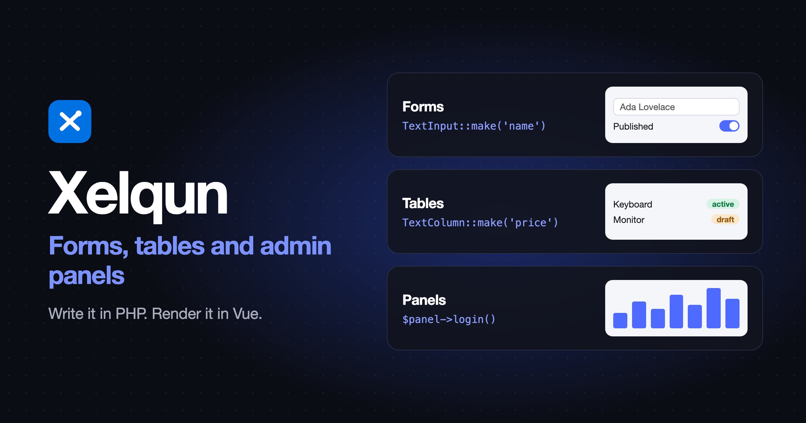

<p align="center">
    
</p>

<p align="center">
    <a href="https://laravel.com"></a>
    <a href="https://inertiajs.com"></a>
    <a href="https://vuejs.org"></a>
    <a href="https://php.net"></a>
</p>

**Xelqun is an open-source stack for building forms, tables and admin panels with Laravel, Inertia and Vue.**

You write your forms, tables and admin panels in PHP, and Xelqun turns them into a working Vue interface. It also handles validation and saving to the database for you, so most of the time you don't need to write any Vue. When you do want something custom, you can add your own Vue components. It's heavily inspired by [Filament](https://filamentphp.com), and brings the same PHP-first way of working to Inertia and Vue.

- **[Forms](https://github.com/199ocero/xelqun-forms)**: Build reactive forms with validation, relationships, uploads, conditional logic and wizards.
- **[Tables](https://github.com/199ocero/xelqun-tables)**: Browse, search and filter records, with inline editing, summaries, and individual or bulk actions.
- **[Panels](https://github.com/199ocero/xelqun-panels)**: Run a full admin panel with authentication, CRUD pages, tenancy and global search.
- **Infolists**: Present read-only record details with structured layouts and custom formatting.
- **Notifications**: Keep users informed with toasts and a notification bell.
- **Dashboard widgets**: Bring stats, charts, lists and tables together in one place.
- **Actions**: Connect buttons to PHP, with confirmations, modal forms and feedback.

[Get Started](https://xelqun.com/introduction) • [Launch Demo](https://demo.xelqun.com)

---

## Installation

Panels is built on Forms and Tables, and its installer sets up all three:

```bash
composer require xelqun/panels
php artisan xelqun-panels:install
```

Only need one piece? Install [`xelqun/forms`](https://xelqun.com/forms/installation) or [`xelqun/tables`](https://xelqun.com/tables/installation) by itself.

Xelqun is alpha. Until 1.0, a minor version can break existing code, and each package's changelog lists every break.

## Contributing

This repository is the Xelqun website: the [documentation](https://xelqun.com) and the [demo](https://demo.xelqun.com). The code for each package lives in its own repository: [Forms](https://github.com/199ocero/xelqun-forms), [Tables](https://github.com/199ocero/xelqun-tables) and [Panels](https://github.com/199ocero/xelqun-panels).

## Need Help?

🐞 If you spot a bug in a package, please open an issue on [Forms](https://github.com/199ocero/xelqun-forms/issues), [Tables](https://github.com/199ocero/xelqun-tables/issues) or [Panels](https://github.com/199ocero/xelqun-panels/issues).

📖 If you spot a mistake in the docs or the demo, please [open an issue here](https://github.com/199ocero/xelqun/issues).

## License

Xelqun is open-source software licensed under the [MIT license](https://opensource.org/licenses/MIT).
